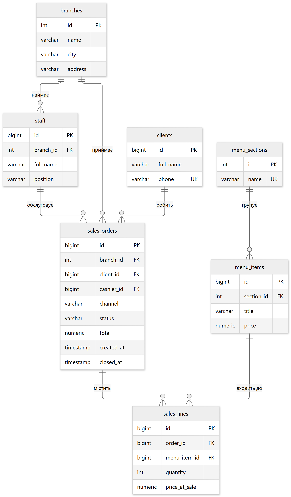
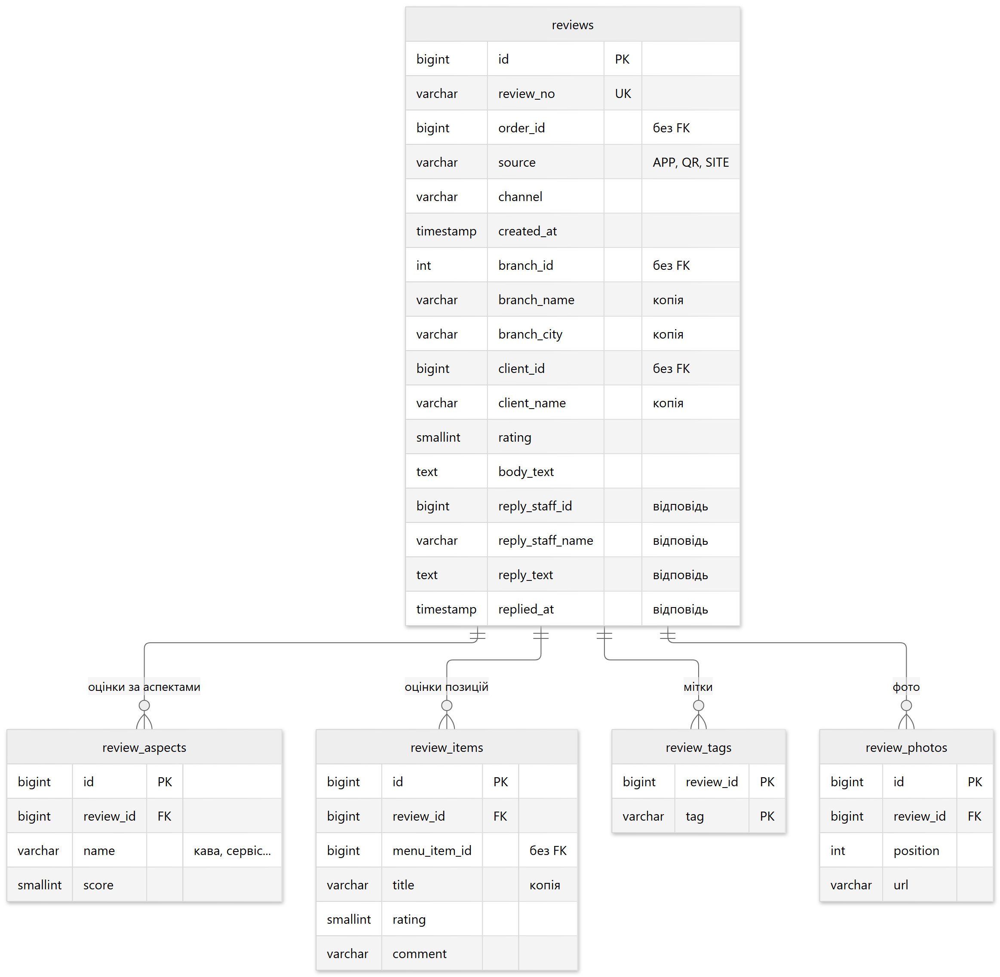

# Мережі кав'ярень

Облік замовлень і відгуків клієнтів на трьох сховищах: PostgreSQL, MongoDB і Redis.

## Задача

Є реляційна база мережі кав'ярень. Треба знайти в ній дані, яким реляційна модель
заважає, винести їх у NoSQL, повторити те саме в SQL і заміряти різницю.

Робота йде в такому порядку: спершу дивимось, що взагалі є в базі, далі знаходимо
проблемну сутність, обираємо під неї тип сховища, реалізуємо обидва варіанти
й порівнюємо на однакових даних.

## Мережа кав'ярень у базі даних

Кілька філій у різних містах. Гість робить замовлення в залі, на винос або з доставкою,
бариста пробиває позиції з меню, замовлення закривається. Після цього гість може лишити
відгук — через застосунок, за QR-кодом зі столика або на сайті.

| Блок | Таблиці | Призначення |
|---|---|---|
| Мережа | `branches`, `staff` | філії та працівники |
| Меню | `menu_sections`, `menu_items` | напої та страви з цінами |
| Клієнти | `clients` | постійні гості |
| Продаж | `sales_orders`, `sales_lines` | замовлення та його позиції |
| Відгуки | `reviews`, `review_aspects`, `review_items`, `review_tags`, `review_photos` | відгук про візит |

Перші чотири групи — це каса. Дані там весь час рухаються: бариста додає позиції,
сума перераховується тригером, замовлення переходить зі стану `NEW` у `CLOSED`.



Разом у базі 12 таблиць, 15 індексів, 7 збережених процедур, 5 функцій, 4 подання
та тригер перерахунку суми — усе через 20 ченджсетів Liquibase.

## Відгук: у чому проблема

У вихідній базі відгук виглядає так:

```sql
CREATE TABLE reviews (
    id       BIGSERIAL PRIMARY KEY,
    order_id BIGINT   NOT NULL,
    rating   SMALLINT NOT NULL,
    comment  TEXT
);
```

Оцінка від одного до п'яти й текст. З такого відгуку не видно, що саме сподобалось,
а що ні, і менеджеру філії з ним нічого робити.

Застосунок має збирати значно більше:

- окремі оцінки за аспектами — кава, сервіс, швидкість, атмосфера, чистота,
  причому гість заповнює не всі;
- оцінку кожного напою чи страви із замовлення з власним коментарем;
- мітки на кшталт «швидко», «черга», «затишно»;
- фотографії, від жодної до кількох;
- відповідь менеджера філії;
- джерело відгуку — застосунок, QR-код зі столика чи сайт.

Якщо лишати все в реляційній моделі, одна сутність розтягується на **п'ять таблиць**:
шапка, аспекти, оцінки позицій, мітки й фото. Кожне читання відгуку збирає їх назад,
хоча показують відгук завжди цілком.



### Чому в таблицях відгуку немає зовнішніх ключів

`reviews.branch_id`, `reviews.client_id` і `review_items.menu_item_id` — звичайні числа.
Поряд із ними лежать `branch_name`, `branch_city`, `client_name`, `title` — копії,
зняті в момент написання відгуку.

Пояснити це просто на прикладі. Гість поставив дві зірки філії «Подільська» й написав
про довгу чергу. Через рік мережа перейменовує філію або закриває її. При посиланні
на `branches` цей відгук або почне показувати нову назву, або взагалі перестане
відкриватися через видалений рядок. Відгук — це свідчення про конкретний візит,
воно має лишитися таким, яким його написали. Так само з напоєм: якщо «Лате»
перейменують на «Лате на вівсяному», у старому відгуку має лишитись стара назва.

---

## Вибір сховища

### Чим відрізняються типи NoSQL баз

| Тип | Як зберігає дані | У чому сильний | У чому слабкий | Де придався б у мережі кав'ярень |
|---|---|---|---|---|
| Документне — MongoDB, Couchbase | документ JSON/BSON, вкладеність довільна | запис лежить цілим шматком, два документи можуть мати різні поля, індексувати можна й вкладені | з'єднати дві колекції не вийде, однакові назви дублюються в тисячах документів | відгуки; картки напоїв, де в кожного свій набір характеристик |
| Key-value — Redis, Memcached, DynamoDB | пара «ключ — значення», значенню можна задати строк життя | читання за ключем швидше за будь-яке інше сховище, усе тримається в пам'яті | шукати за вмістом значення не можна взагалі | показники дня, кеш, одноразові ключі на кшталт захисту від повторного відгуку |
| Пошукове — Elasticsearch, OpenSearch | документи в інвертованому індексі | пошук по тексту з ранжуванням і фільтрами | тримати як єдине джерело правди дорого й ризиковано | пошук по текстах відгуків |
| Графове — Neo4j, JanusGraph | вершини та ребра, у кожного свої властивості | проходить ланцюжки зв'язків будь-якої довжини | погано працює, коли треба просканувати все | «з чим зазвичай беруть цей напій», гості зі схожими смаками |
| Колонкове — Cassandra, HBase, ScyllaDB | рядок із родинами колонок, розкиданий по вузлах за ключем | запис масштабується додаванням вузлів, рядок може мати тисячі колонок і майже всі порожні | дістати дані можна лише тим способом, під який спроєктовано ключ | безперервний потік подій з касових терміналів усіх філій |
| Часових рядів — TimescaleDB, InfluxDB | значення метрики з позначкою часу й тегами | добре стискає й рахує по часових вікнах | поза своєю задачею майже некорисне | завантаженість філій по годинах, температура кавомашин |

Перші два рядки — ті, що лягають на задачу; решта наведені для повноти картини
й у цій роботі не використовуються.

### Що з бази можна виносити

Пройшовся по всіх сутностях і розклав їх на дві купи.

**Лишаються в PostgreSQL:**

- `sales_orders` і `sales_lines` — поки замовлення відкрите, воно змінюється щохвилини,
  сума перераховується тригером, а помилка посеред обслуговування має відкотити все.
  Це рівно той випадок, заради якого реляційні бази й існують;
- `clients` — телефон має лишатися унікальним, клієнт бере участь у замовленнях;
- `menu_sections` і `menu_items` — кілька десятків рядків, назва унікальна в межах
  розділу, на позиції посилаються рядки замовлення;
- `branches` і `staff` — маленькі довідкові таблиці, які місяцями не змінюються.

Жодній із них реляційна модель не заважає: даних мало, структура фіксована,
зв'язки потрібні.

**Виноситься:**

- `reviews` разом із усім, що до них додається. Пишуться один раз, у кожного свій
  набір заповнених полів, кількість росте нескінченно, і на роботу каси вони
  не впливають ніяк.

### Чому відгук лягає саме на документну модель

1. **Набір полів різний у кожного відгуку.** Один гість поставив лише загальну оцінку,
   другий заповнив п'ять аспектів і додав три фото, третій оцінив кожен напій окремо.
   Реляційно під кожну частину потрібна таблиця; у документі це вкладені списки,
   яких може не бути взагалі.
2. **Пишеться один раз, далі лише читається.** Єдина зміна — відповідь менеджера.
   Окремі поля відгуку ніхто не править.
3. **Показують відгук завжди цілком** — і в стрічці філії, і в картці гостя.
   Жоден екран не показує «тільки мітки» чи «тільки аспекти».
4. **Вкладеність глибша за один рівень.** Оцінка позиції має власний коментар,
   тобто це список усередині списку.
5. **Відгуків стає дедалі більше.** Таблиці каси читають і пишуть при кожному
   обслуговуванні, їх краще тримати невеликими; відгуки накопичуються роками.
6. **Відгук ні з чим не зберігається в одній операції.** Немає дії, у якій відгук
   і якийсь інший запис мали б зберегтися обидва або не зберегтися взагалі —
   а саме це зазвичай і заважає рознести дані по різних базах.

Вибір: **MongoDB** для відгуків, **Redis** — для оперативних показників дня.

---

## Відгук як документ MongoDB

Колекція `reviews`:

```json
{
  "reviewNo": "RV-0000001",
  "orderId": 1,
  "source": "QR",
  "channel": "HALL",
  "createdAt": "2026-11-09T18:02:11",
  "branch": { "id": 1, "name": "Центральна", "city": "Київ" },
  "client": { "id": 2, "name": "Дмитро Савченко", "phone": "+380501110012" },
  "rating": 4,
  "text": "Капучино чудове, чізкейк трохи сухуватий.",
  "aspects": [
    { "name": "кава", "score": 5 },
    { "name": "сервіс", "score": 4 }
  ],
  "items": [
    { "menuItemId": 3, "title": "Капучино", "rating": 5, "comment": "ідеальна пінка" },
    { "menuItemId": 7, "title": "Чізкейк", "rating": 3, "comment": "сухуватий" }
  ],
  "tags": ["швидко", "затишно"],
  "photos": ["https://cdn.cafenet.example/reviews/demo-1.jpg"],
  "reply": {
    "staffId": 2,
    "staffName": "Андрій Шевчук",
    "text": "Дякуємо за відгук, передамо кухні.",
    "repliedAt": "2026-11-09T19:40:02"
  }
}
```

Відгук без фото, без міток і без оцінок окремих позицій лежить у тій самій колекції —
просто без цих полів. Блок `reply` з'являється лише після відповіді менеджера.

Сім індексів колекції створює `MongoReviewRepository.ensureIndexes` під час старту:

| Індекс | Для чого |
|---|---|
| `{reviewNo: 1}` unique | пошук відгуку за номером |
| `{"branch.id": 1, createdAt: -1}` | відгуки філії за період |
| `{createdAt: -1}` | вибірки за період |
| `{rating: 1}` | відбір за оцінкою |
| `{tags: 1}` | багатоключовий — відбір за міткою |
| `{"items.menuItemId": 1}` | багатоключовий — відгуки про конкретний напій |
| `{"aspects.name": 1}` | багатоключовий по вкладених оцінках |

Документ будує `ReviewService.leave`: бере закрите замовлення з подань `v_orders`
і `v_order_lines`, бере аспекти, оцінки позицій, мітки й фото з тіла запиту —
у реляційній моделі замовлення цих даних немає — і пише результат у MongoDB.

---

## Контрольна реалізація в PostgreSQL

Той самий відгук реалізовано ще й реляційно, інакше не буде з чим порівнювати.
Документ розкладається на п'ять таблиць (`03-reviews.sql`):

```
reviews                шапка: номер, джерело, канал, копії даних філії та клієнта,
                       загальна оцінка, текст, відповідь менеджера
  review_aspects       оцінки за аспектами
  review_items         оцінки окремих позицій замовлення
  review_tags          мітки
  review_photos        фотографії
```

Дев'ять індексів повторюють індекси MongoDB один в один: `uq_reviews_no`,
`(branch_id, created_at DESC)`, `(created_at DESC)`, `(rating)`,
`review_aspects (review_id)`, `review_aspects (name)`, `review_items (review_id)`,
`review_items (menu_item_id)`, `review_tags (tag)`, `review_photos (review_id)`.

### Як код звертається до бази

Прямих `INSERT` і `SELECT` по таблицях у коді немає — усе через об'єкти, створені
в самій базі. Нагадування, що це таке:

- `sp_…` — **збережена процедура**, програма всередині бази, яка змінює дані;
- `fn_…` — **функція**, програма всередині бази, яка повертає результат обчислення;
- `v_…` — **подання** (view), збережений запит, до якого звертаються як до таблиці.

Для відгуків їх дев'ять (`04-reviews-api.sql`):

| Назва | Призначення |
|---|---|
| `v_reviews_full` | повний відгук: `reviews ⋈ review_items` плюс аспекти, мітки й фото, зібрані в масиви через `array_agg` |
| `v_reviews` | список відгуків із кількістю позицій і фото |
| `fn_branch_ratings` | середня оцінка та кількість відгуків по філіях |
| `fn_aspect_stats` | середня оцінка за кожним аспектом |
| `fn_reviews_by_tag` | відгуки із заданою міткою |
| `sp_review_add` | пише відгук у всі п'ять таблиць **одним викликом**: аспекти, позиції, мітки й фото передаються масивами та розгортаються через `generate_subscripts` і `unnest` |
| `sp_review_reply` | записує відповідь менеджера |
| `sp_reviews_clear` | очищає таблиці перед вимірюванням |
| `sp_reviews_analyze` | збирає статистику для планувальника після масового завантаження |

Скільки коштує нормалізація, видно в `ReviewRepository.assemble`: один відгук
приходить набором рядків «відгук × позиція», аспекти, мітки й фото — трьома масивами,
і все це треба скласти назад у пам'яті. Документна модель цього кроку не має взагалі.

---

## Замір швидкодії

### Умови

Порівнювати має сенс лише тоді, коли обом сховищам дано однакові можливості.
Що для цього зроблено:

| Умова | Як забезпечено |
|---|---|
| Однакові дані | `ReviewGenerator` будує набір від фіксованого початкового числа генератора випадкових чисел, тому обидва сховища отримують ті самі відгуки, а прогони можна порівнювати між собою |
| Однакові індекси | кожному індексу MongoDB відповідає такий самий у PostgreSQL — переліки наведені вище |
| Однакова надійність запису | PostgreSQL працює зі стандартним `synchronous_commit = on`, тому MongoDB пише з `WriteConcern.JOURNALED`: підтвердження лише після журналу |
| Однакова кількість звернень | відгук пишеться одним викликом з обох боків: `insertOne` проти `CALL sp_review_add` з масивами замість вставки кожного аспекта окремо |
| Реляційній стороні дано найкращий варіант | читання можна було зробити п'ятьма запитами, і PostgreSQL програв би за кількістю звернень; замість цього `v_reviews_full` збирає аспекти, мітки й фото підзапитами в масиви, а з'єднання лишається тільки з позиціями |
| Планувальник має статистику | після масового завантаження викликається `sp_reviews_analyze`, інакше PostgreSQL обирає гірший план на порожній статистиці |
| Виміряне — не перші запуски | 40 прогрівних ітерацій відкидаються, вимірюються наступні 150; з'єднання відкривається раз на сценарій, щоб не міряти вартість підключення |
| Видно розкид, а не лише середнє | у звіті `min`, `p50`, `p95`, `max`; кожен обсяг прогнано тричі, у таблицях медіана |
| Однакова мережа | застосунок і обидві бази — контейнери в одній мережі |
| Видно, що порівнювалась однакова робота | кожен сценарій повертає кількість отриманих елементів, вона є в таблицях |

Запуск прогону:

```bash
curl -X POST "http://localhost:8090/api/benchmark/run?reviews=5000&iterations=150&warmup=40"
```

Прогін очищає колекцію `reviews` і таблиці `review*` перед наповненням.

### Що саме міряли

Сценарії йдуть від найлегшої операції до найважчої.

| Сценарій | Операція | MongoDB | PostgreSQL |
|---|---|---|---|
| `read-review` | повний відгук за номером | `find({reviewNo})` | `SELECT` з `v_reviews_full` |
| `reply-review` | відповідь менеджера | `updateOne` у вкладений об'єкт | `UPDATE` одного рядка за унікальним індексом |
| `write-review` | новий відгук | `insertOne` | `CALL sp_review_add` — вставка у 5 таблиць однією транзакцією |
| `tag-search` | 50 відгуків із міткою | `find({tags: …})` по багатоключовому індексу | з'єднання `review_tags` з `reviews` |
| `aspect-stats` | середня оцінка за аспектами | `$match → $unwind → $group` | з'єднання `review_aspects` з `reviews`, `GROUP BY name` |
| `branch-ratings` | середня оцінка по філіях | `$match → $group` по `branch.id` | `GROUP BY branch_id` по таблиці `reviews` |
| `branch-feed` | усі відгуки філії за півроку | індекс `{branch.id, createdAt}`, готові документи | індекс `(branch_id, created_at)`, з'єднання й три підзапити на кожен відгук |

### Підсумок заміру

`×` — у скільки разів MongoDB швидша; менше одиниці означає, що швидша PostgreSQL.

| Сценарій | × на 5 000 | × на 20 000 | Хто швидший | Куди рухається з обсягом |
|---|---|---|---|---|
| `read-review` | 1,11 | 1,41 | MongoDB | відрив росте |
| `branch-feed` | 3,55 | 3,98 | MongoDB | відрив росте |
| `write-review` | 0,89 | 0,95 | паритет | без змін |
| `reply-review` | 0,74 | 0,59 | PostgreSQL | відрив росте |
| `tag-search` | 0,52 | 0,73 | PostgreSQL | скорочується |
| `aspect-stats` | 0,39 | 0,38 | PostgreSQL | без змін |
| `branch-ratings` | 0,13 | 0,11 | PostgreSQL | відрив росте |

### Детальні цифри

Час однієї операції в мілісекундах, медіана трьох прогонів по 150 вимірюваних ітерацій.
У колонці «прогони» — коефіцієнт у кожному з трьох, щоб було видно розкид.

**5 000 відгуків:**

| Сценарій | Елементів | MongoDB avg / p95 | PostgreSQL avg / p95 | × | прогони |
|---|---|---|---|---|---|
| `read-review` | 2 | 0,27 / 0,61 | 0,30 / 0,55 | 1,11 | 1,29 / 1,10 / 1,13 |
| `reply-review` | 1 | 1,45 / 2,50 | 1,07 / 1,97 | 0,74 | 0,70 / 0,69 / 0,80 |
| `write-review` | 1 | 1,52 / 2,77 | 1,35 / 2,11 | 0,89 | 0,97 / 0,85 / 0,98 |
| `tag-search` | 50 | 1,66 / 2,48 | 0,86 / 1,36 | 0,52 | 0,85 / 0,49 / 0,56 |
| `aspect-stats` | 5 | 18,85 / 23,90 | 7,36 / 8,16 | 0,39 | 0,47 / 0,39 / 0,34 |
| `branch-ratings` | 3 | 15,09 / 16,90 | 1,95 / 2,42 | 0,13 | 0,16 / 0,13 / 0,12 |
| `branch-feed` | 1661 | 13,44 / 17,42 | 47,66 / 54,45 | 3,55 | 4,09 / 3,55 / 3,38 |

**20 000 відгуків:**

| Сценарій | Елементів | MongoDB avg / p95 | PostgreSQL avg / p95 | × | прогони |
|---|---|---|---|---|---|
| `read-review` | 2 | 0,25 / 0,68 | 0,35 / 0,95 | 1,41 | 1,41 / 2,71 / 1,28 |
| `reply-review` | 1 | 1,70 / 3,04 | 1,01 / 2,04 | 0,59 | 0,55 / 0,57 / 0,62 |
| `write-review` | 1 | 1,52 / 2,90 | 1,45 / 2,20 | 0,95 | 0,96 / 1,00 / 0,81 |
| `tag-search` | 50 | 1,40 / 2,21 | 1,02 / 1,43 | 0,73 | 0,65 / 0,73 / 0,71 |
| `aspect-stats` | 5 | 75,24 / 86,13 | 28,43 / 32,28 | 0,38 | 0,39 / 0,40 / 0,37 |
| `branch-ratings` | 3 | 53,24 / 62,04 | 5,75 / 6,86 | 0,11 | 0,10 / 0,11 / 0,12 |
| `branch-feed` | 6740 | 49,69 / 57,84 | 197,71 / 221,40 | 3,98 | 3,69 / 4,21 / 3,95 |

Наповнення обох сховищ: 3,6 с на 5 000 відгуків і 13,2 с на 20 000. Заміри зняті
на PostgreSQL 16 і MongoDB 7. Абсолютні значення залежать від машини, співвідношення
між сховищами стабільне.

### Чому вийшло саме так

Межа проходить не між «швидко» і «повільно», а між двома видами запитів.

**Коли потрібен відгук цілком, швидша MongoDB.** На одному відгуку перевага невелика
(1,11×), але вона **росте з обсягом** до 1,41×: вартість з'єднань у PostgreSQL
збільшується, вартість читання одного документа — ні. На стрічці філії це вже 4×.
Причина проста: щоб віддати 6 740 відгуків, PostgreSQL з'єднує їх із позиціями
й тричі звертається за аспектами, мітками та фото **для кожного відгуку**, а потім
усе це складається назад у коді. MongoDB читає 6 740 готових документів.

**Коли з відгуку потрібні одне-два поля, швидша PostgreSQL, і то в рази.**
`branch-ratings` — найбільший розрив узагалі, дев'ятикратний. Середня оцінка рахується
за одним числовим полем, і реляційно це вузька таблиця `reviews`, де поряд лежать
`branch_id` і `rating`. MongoDB для того самого мусить підняти документи цілком —
разом із текстом, аспектами, позиціями, мітками й фото, які для середнього не потрібні.
Те саме на `aspect-stats` — 2,5× на користь PostgreSQL.

Це і є ціна денормалізації: документ зручний, коли потрібен увесь, і дорогий, коли
потрібні два поля з нього.

**Пошук за міткою дав протилежне до очікуваного.** Багатоключовий індекс мав би дати
MongoDB перевагу, але `review_tags` — вузька таблиця з двох колонок, і з'єднати
50 рядків дешевше, ніж прочитати 50 повних документів.

**Запис — паритет, оновлення дорожче в MongoDB.** Різниця на `write-review` у межах
розкиду між прогонами. А `reply-review` стабільно програє: при відповіді менеджера
MongoDB переписує документ цілком, тоді як PostgreSQL змінює чотири поля в одному рядку.

### Висновок

Винесення відгуків у документне сховище виправдане двома речами разом.

Структурою: відгук із довільним набором аспектів, оцінок позицій, міток і фото
природно лягає в документ, а реляційно потребує п'яти таблиць і складання в коді.

Швидкодією на головному сценарії застосунку: стрічка відгуків філії — те, що
відкривають найчастіше, — працює вчетверо швидше.

Якби ж система зводилась до звітів «середня оцінка по філіях за місяць», виносити
відгуки не було б сенсу: на таких запитах реляційна модель швидша на порядок.
У робочій системі це вирішується тим, що показники рахуються в момент появи відгуку
й лежать у Redis, а не перебираються з усієї колекції.

---

## Redis: дані, які не треба зберігати надовго

MongoDB закрила зберігання відгуків, але лишились дві задачі: показувати поточні
показники дня і не дати лишити десять відгуків на одне замовлення. Ці дані живуть
години, читаються постійно й будь-коли відновлюються з відгуків.

`RedisReviewBoard` працює з базовими структурами:

| Тип значення | Ім'я ключа | Команди | Для чого |
|---|---|---|---|
| STRING | `cafenet:stats:<день>:count` | `INCR`, `GET` | скільки відгуків за день |
| HASH | `cafenet:stats:<день>:marks` | `HINCRBY`, `HGETALL` | розподіл оцінок від 1 до 5 |
| HASH | `cafenet:stats:<день>:sources` | `HINCRBY`, `HGETALL` | звідки прийшли: застосунок, QR, сайт |
| ZSET | `cafenet:branch-score:<день>` | `ZINCRBY`, `ZREVRANGE WITHSCORES` | сума оцінок по філіях |
| ZSET | `cafenet:branch-count:<день>` | `ZINCRBY`, `ZSCORE` | кількість відгуків по філіях |
| LIST | `cafenet:feed` | `LPUSH`, `LTRIM`, `LRANGE` | стрічка 50 останніх відгуків |
| STRING + TTL | `cafenet:review:<номер>` | `SET` з `EX`, `GET`, `TTL`, `DEL` | кеш готового відгуку, 15 хвилин |
| STRING + TTL | `cafenet:cooldown:<замовлення>` | `SET NX EX`, `TTL` | захист від повторного відгуку |

Два місця, де key-value дає те, чого інші сховища зручно не дають.

**Середня оцінка філії за день** рахується з двох наборів одразу: у першому
накопичується сума оцінок, у другому — кількість відгуків. Ділення одного на інше
дає середнє без жодного перебору відгуків — саме те, чого бракує MongoDB
на `branch-ratings`.

**Захист від повторних відгуків** — ключ створюється операцією «записати, лише якщо
такого ще немає» і сам зникає через заданий час. Другий відгук на те саме замовлення
в межах цього часу не пройде, а прибирати нічого не треба: ключ видаляється сам.
Реляційно для цього знадобилась би таблиця й регулярне чищення старих рядків.

Сховища працюють у парі: `ReviewService.byNo` спершу дивиться в Redis і лише при
промаху йде в MongoDB, після чого кладе результат у кеш. Відповідь менеджера прибирає
відгук із кешу, щоб наступне читання взяло свіжу версію. Табло — похідні дані, тому
недоступність Redis не скасовує збережений відгук: `leave` лише пише попередження в лог.

---

## Запуск і перевірка

Нічого, крім Docker, ставити не доведеться: збірка відбувається всередині контейнера,
тож ані Java, ані Maven на машині не потрібні.

```bash
docker compose up -d --build
```

| Що відкрити | Адреса | Коментар |
|---|---|---|
| API | http://localhost:8090/api/ping | Liquibase накатує схему на старті, індекси MongoDB створюються там же |
| Adminer | http://localhost:8091 | сервер `db`, база `cafenet`, користувач `cafenet`, пароль `cafenet` |
| mongo-express | http://localhost:8092 | колекція `cafenet_reviews.reviews` |
| PostgreSQL | localhost:5434 | `cafenet` / `cafenet` / `cafenet` |
| MongoDB | localhost:27018 | база `cafenet_reviews` |
| Redis | localhost:6380 | ключі з префіксом `cafenet:` |

Зупинка разом з даними:

```bash
docker compose down -v
```

Готові до запуску запити — у файлі `requests.http`. Порядок перевірки: створити
замовлення, лишити на нього відгук, прочитати відгук за номером, подивитись табло
в `/api/live`, спробувати лишити другий відгук на те саме замовлення (має прийти
відмова), запустити прогін швидкодії.

## Склад проєкту

```
src/main/resources/db/changelog/
  master.yaml
  changesets/
    01-core.sql           7 таблиць каси та індекси до них
    02-core-api.sql       функція суми, тригер, 2 подання, 3 процедури
    03-reviews.sql        5 таблиць відгуку, 9 індексів — ті самі, що в MongoDB
    04-reviews-api.sql    2 подання, 4 процедури, 3 функції
    05-demo-data.sql      початкові дані: філії, меню, працівники, клієнти

src/main/java/ua/lab/cafenet/
  domain/Rows.java        моделі читання, зокрема Review з вкладеними записами
  persistence/            StatementRunner, UnitOfWork, JdbcUnitOfWork, фабрика, винятки
  persistence/repository/ SalesRepository, ReviewRepository — відгук у реляційній моделі
  nosql/mongo/            ReviewDocuments       відгук ↔ BSON-документ
                          MongoReviewRepository колекція, індекси, агрегації
                          MongoIndexSetup       створення індексів на старті
  nosql/redis/            RedisReviewBoard      структури key-value сховища
  nosql/bench/            ReviewGenerator       відтворюваний генератор відгуків
                          BenchmarkService      сценарії, прогрів, вимірювання
                          Measurement           min / p50 / p95 / max
  service/                SalesService          замовлення й закриття
                          ReviewService         побудова документа, читання через кеш
  api/                    SalesController, ReviewController, LiveController,
                          BenchmarkController, PingController, обробник помилок
```

## API

| Запит | Адреса | Що робить |
|---|---|---|
| `GET` | `/api/ping` | стан застосунку |
| `POST` | `/api/orders` | створити й закрити замовлення |
| `POST` | `/api/reviews/from-order/{orderId}` | лишити відгук на закрите замовлення |
| `GET` | `/api/reviews/{reviewNo}` | повний відгук (Redis → MongoDB) |
| `GET` | `/api/reviews?branchId&from&to` | відгуки філії за період |
| `GET` | `/api/reviews/branch-ratings?from&to` | середня оцінка по філіях |
| `GET` | `/api/reviews/aspect-stats?from&to` | середні оцінки за аспектами |
| `GET` | `/api/reviews/by-tag?tag&limit` | відгуки з міткою |
| `POST` | `/api/reviews/{reviewNo}/reply` | відповідь менеджера |
| `GET` | `/api/live/counters?day` | лічильники дня |
| `GET` | `/api/live/branch-board?day&limit` | рейтинг філій за день |
| `GET` | `/api/live/feed?limit` | стрічка останніх відгуків |
| `GET` | `/api/live/cache/{reviewNo}` | вміст кеша та скільки йому лишилось жити |
| `GET` | `/api/live/cooldown/{orderId}` | чи можна лишити ще один відгук |
| `POST` | `/api/benchmark/run?reviews&iterations&warmup` | порівняння швидкодії |
| `DELETE` | `/api/benchmark` | прибрати навантажувальні дані |

П'ять запитів до відгуків — за номером, стрічка філії, рейтинг філій, статистика
аспектів і пошук за міткою — це рівно ті операції, що порівнюються в прогоні.
Таблиці `review*` у PostgreSQL наповнює тільки прогін: справжні відгуки живуть
у MongoDB, реляційна реалізація потрібна для порівняння.

Коди відповідей: `404` — не знайдено, `409` — порушено правило (повторний відгук,
незакрите замовлення, `RAISE EXCEPTION` у процедурі), `400` — помилка валідації.

---